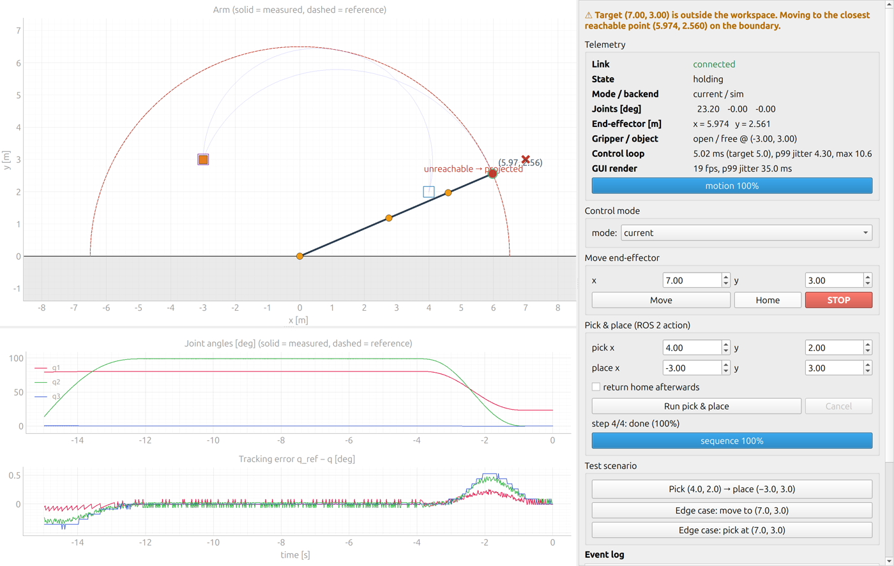

# 3-DoF Planar Arm: ROS 2 Control + Real-Time Telemetry GUI

Kineshia Robotics take-home (Robotics Software Engineer, ROS 2 & GUI Systems).

A ROS 2 system for the provided 3-DoF planar arm. It includes:

* a **lifecycle controller node** with smooth quintic trajectories and three
  selectable **control modes** (position, velocity, current with PID tracking);
* a **PyQt5/PyQtGraph operator GUI** that runs the Qt event loop and the ROS 2
  executor side by side;
* a **pick-and-place ROS 2 action** with feedback and cancel;
* a **Gazebo backend** driven through `ros_gz_bridge` by the *same* controller;
* **tests**, a **jitter benchmark** and a profiling note.


| Core requirement | Where |
|---|---|
| Controller node: target → IK → quintic trajectory → `JointState` at a fixed rate, limits and ground enforced, swappable hardware backend | `controller_node.py`, `planning.py`, `trajectory.py`, `backends.py` |
| Telemetry GUI: live arm, joint plots, EE telemetry, pick/place input, Qt + ROS without blocking | `gui_node.py`, `gui_window.py` |
| Pick-and-place sequence | `pick_place.py` + `/pick_place` action |
| Package hygiene: ament_python package, launch file, README | this file, `launch/` |

| Stretch goal | Status |
|---|---|
| Multiple control modes (`position`, `velocity`, `current`) selected by parameter and switchable at runtime, PID tracking loop, live error plot | done |
| ROS 2 action for the full pick-and-place, with feedback and cancel | done |
| Gazebo (`ros_gz`): arm spawned in gz sim, same controller over a bridged command pipeline | done (position mode) |



---

## Build

Tested on **Ubuntu 26.04 + ROS 2 Lyrical** (the brief suggests Jazzy/Humble;
only standard rclpy APIs are used, so they should work too).

```bash
sudo apt install python3-pyqt5 python3-pyqtgraph            # GUI
sudo apt install ros-$ROS_DISTRO-ros-gz                       # only for Gazebo
cd kineshia_ros2_arm_task                                     # colcon workspace root
source /opt/ros/$ROS_DISTRO/setup.bash
colcon build --symlink-install
source install/setup.bash
```

The workspace has two packages:

| Package | Type | Contents |
|---|---|---|
| `planar_arm_interfaces` | ament_cmake | `MoveToTarget.srv`, `MoveJoints.srv`, `PickPlace.action`, `ControllerStatus.msg` |
| `planar_arm_control` | ament_python | nodes, library code, launch files, config, Gazebo world, tests |

## Run

```bash
# Controller + GUI (simulated arm)
ros2 launch planar_arm_control bringup.launch.py

# The GUI plays the fixed test scenario by itself 
ros2 launch planar_arm_control bringup.launch.py demo:=true

# Choose a control mode at startup
ros2 launch planar_arm_control bringup.launch.py control_mode:=current

# Same controller, arm in Gazebo (gz sim) via ros_gz_bridge
ros2 launch planar_arm_control gazebo.launch.py            # headless:=true to skip gz GUI
```

### Test scenario (from the brief)

In the GUI's **Test scenario** box:

1. **Pick (4.0, 2.0) → place (−3.0, 3.0)**: runs the `/pick_place` action.
   The orange block is picked up, carried and placed. The sequence progress bar
   is driven by action feedback.
2. **Edge case: move to (7.0, 3.0)**: the target is 7.6 m from the base, beyond
   the 6.5 m reach. The provided IK projects it onto the boundary at
   (5.974, 2.560), and the GUI makes that visible:
   * an orange banner explains the projection;
   * a red ✖ marks the requested point and a green ring marks the reachable one;
   * a dotted line joins them, and the workspace boundary turns red.

   The arm moves to the reachable point.
3. **Edge case: pick at (7.0, 3.0)**: for pick-and-place, a projected target
   is **rejected before anything moves**. Grasping at a point other than where
   the object is would be wrong, so the action aborts with a clear reason.

From the command line:

```bash
ros2 action send_goal --feedback /pick_place planar_arm_interfaces/action/PickPlace \
  "{pick: {x: 4.0, y: 2.0}, place: {x: -3.0, y: 3.0}}"
ros2 service call /move_to_target planar_arm_interfaces/srv/MoveToTarget "{target: {x: 7.0, y: 3.0}}"
ros2 param set /controller_node control_mode current
ros2 lifecycle set /controller_node deactivate     # stops the control loop; commands refused
```

---


### Interfaces

| Name | Type | Notes |
|---|---|---|
| `/joint_states` | `sensor_msgs/JointState` | measured q, q̇, effort at `publish_rate_hz` |
| `/joint_reference` | `sensor_msgs/JointState` | trajectory q, q̇, q̈ (in `effort`), same stamp as above |
| `/controller_status` | `planar_arm_interfaces/ControllerStatus` | state, mode, backend, requested/reachable target, `target_projected`, tracking error, gripper/object, loop timing |
| `/target_pose` | `geometry_msgs/PointStamped` | fire-and-forget target |
| `/move_to_target` | `planar_arm_interfaces/srv/MoveToTarget` | returns `accepted`, `projected`, `reachable_target`, `joint_goal`, `duration`, `message` |
| `/move_joints` | `planar_arm_interfaces/srv/MoveJoints` | joint-space goal (rad), no IK; same limit and ground checks; used by the GUI joint sliders |
| `/home`, `/stop` | `std_srvs/Trigger` | |
| `/gripper` | `std_srvs/SetBool` | virtual gripper (refused while pick-and-place runs) |
| `/pick_place` | `planar_arm_interfaces/action/PickPlace` | feedback: phase, step, phase/total progress, EE; cancellable |

### Key parameters (`config/controller.yaml`)

| Parameter | Default | |
|---|---|---|
| `backend` | `sim` | `sim` or `gazebo` |
| `control_mode` | `position` | `position`, `velocity` or `current`; switchable at runtime while idle |
| `control_rate_hz` / `publish_rate_hz` / `status_rate_hz` | 200 / 50 / 10 | multi-rate loops |
| `max_joint_velocity` / `max_joint_acceleration` | 1.0 rad/s / 2.0 rad/s² | trajectory time-scaling |
| `trajectory_duration` | 0 | > 0 forces a fixed duration |
| `vel_kp`, `vel_ki`, `cur_kp`, `cur_ki`, `cur_kd` | 8, 4, 400, 800, 40 | PID gains |
| `ik_solver` | `corrected` | `corrected`: provided IK with its elbow formula fixed, so joint 3 is used; `library`: `planar_arm.py` IK as is (joint 3 always 0). See the design note |
| `ik_in_subprocess` | `true` | run IK in a worker process (see profiling) |
| `control_thread` | `ros_timer` | or `dedicated` (own thread, absolute deadlines) |
| `encoder_ticks_per_rev`, `sim_gravity` | 4096, true | realism of the simulated actuator |

---

## Tests

```bash
colcon test --packages-select planar_arm_control && colcon test-result --verbose
# -> 31 tests, 0 failures
```

* `test_trajectory.py`: quintic boundary conditions, derivative consistency,
  velocity/acceleration limits, multi-segment trajectories.
* `test_planning.py`: scenario IK, projection of (7, 3), rejection below the
  ground, rejection of invalid Jacobian-fallback solutions, via-point planning,
  a randomised test that no plan ever violates a constraint, and a check that
  `planar_arm.py` is unmodified.
* `test_control_modes.py`: every mode tracks the scenario in closed loop; the
  integral term rejects gravity; anti-windup; hard stops.
* `test_pick_place.py`: step order, payload, up-front rejection, cancel, empty
  grasp.
* `test_controller_integration.py` (**launch_testing**): starts the real node and
  checks the service, projection, the action with feedback, cancel, runtime mode
  switch, and lifecycle deactivate/activate.


